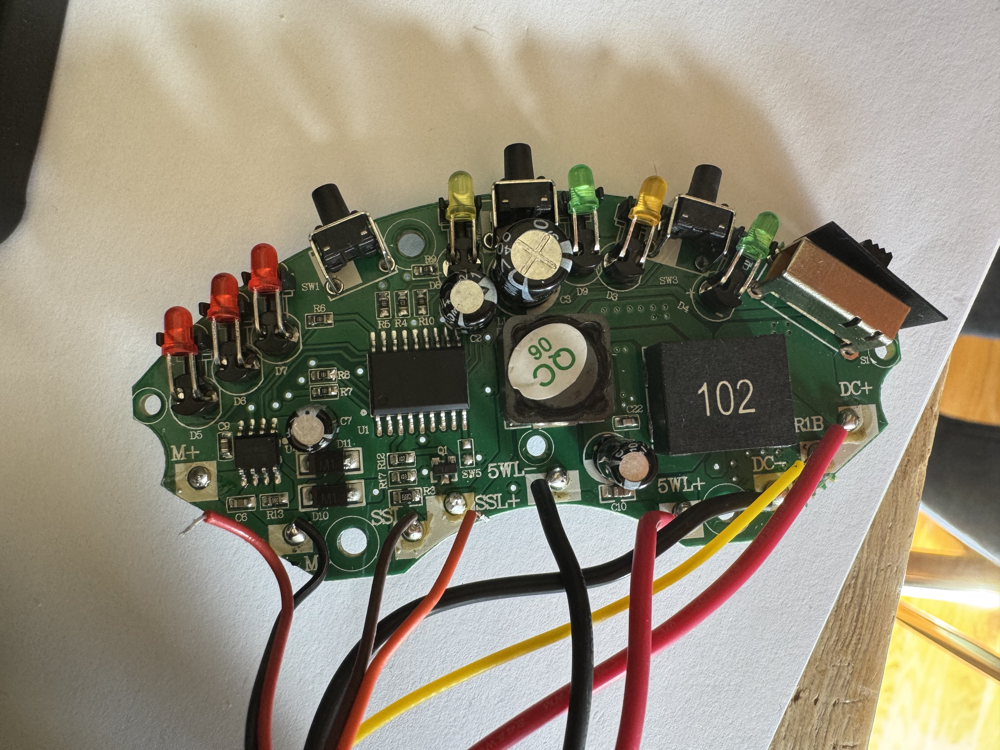
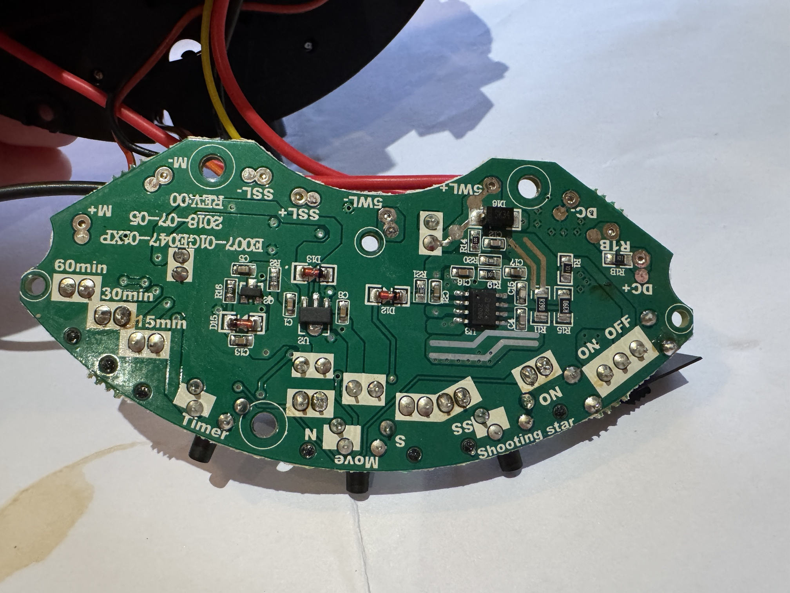

# Repair log

Investigation log for the Homestar Flux fault described in the [README](README.md).

## Where we are

- [x] **1. Characterize the symptoms**
- [x] **2. Rule out the power adapter**
- [ ] **3. Isolate the faulty area** ← we are here
  - [x] Rule out the motor (disconnect `M+`)
  - [x] Identify the motor driver: U4, a Mixic MX08L
  - [ ] Timer test: button side vs output side
  - [ ] Pin checks on U4 (power off)
  - [ ] Remove U4 and retest
- [ ] **4. Identify the failed component**
- [ ] **5. Source a replacement** (MX08L, LCSC C5119041)
- [ ] **6. Repair**
- [ ] **7. Verify** Move (N and S), Shooting Star and Timer

## Investigation

| #   | Date       | Action                                                | Result                                                                                 | Conclusion                                         |
| --- | ---------- | ----------------------------------------------------- | -------------------------------------------------------------------------------------- | -------------------------------------------------- |
| 1   | 2026-11-07 | Press Move                                            | Lamp blinks for a split second, N/S LED flashes then goes out, motor doesn't turn      | The unit resets                                    |
| 2   | 2026-11-07 | Press Shooting Star                                   | Same; SS LED flashes then goes out                                                     | Same fault                                         |
| 3   | 2026-11-07 | Try 5 V/2 A and 5 V/4 A adapters                      | No change                                                                              | Not the adapter                                    |
| 4   | 2026-11-07 | Open the unit, check the motor and belt               | Belt intact, motor shaft never moves                                                   | Not the transmission                               |
| 5   | 2026-11-07 | Review the manual                                     | Shooting stars only run while rotating; rotation reverses (N/S); 5 W at 5 V            | Brownout reset suspected; normal draw about 1 A    |
| 6   | 2026-11-07 | Press Shooting Star alone, rotation never switched on | Same reset                                                                             | Not specific to the Move button                    |
| 7   | 2026-11-07 | Photograph both sides of the board                    | No visible damage; pads and main parts identified                                      | See [board reference](#board-reference)            |
| 8   | 2026-11-07 | Inspect the shooting-star mechanism                   | It depends on the motor turning                                                        | Both buttons go through the motor path             |
| 9   | 2026-11-07 | Disconnect `M+`, press Shooting Star                  | Still resets                                                                           | Motor ruled out; the fault is upstream of it       |
| 10  | 2026-11-07 | Photograph part close-ups (`photos/parts/`)           | U4 is a Mixic MX08L motor driver, U2 a 3.3 V regulator, U1 unmarked; no visible damage | Motor driver identified; see [findings](#findings) |
| 11  | 2026-11-07 | Run re:trace (automated analysis) on the photos       | No parts, markings or real traces found (sees paper and pads, not masked traces)       | [Not usable here](analysis/retrace/README.md)      |
| 12  | 2026-11-07 | Run a PCB-trained YOLO model on the photos            | Finds 41 of 44 parts; ICs and SMD passives right, U4 called a diode on the board view  | [Nothing new](analysis/yolo26/README.md)           |
| 13  | 2026-11-07 | Build a partial board model from the photos           | 45 of 133 pins on a net, mostly assumed; netlist, KiCad schematic and HTML viewer      | [Board model](analysis/pcb-model/README.md)        |
| 14  | 2026-11-08 | Trace audit of the model; wires and 3D traces         | C6 traced across M+/M-; 4 placement-only links downgraded; 6 nets wired                | [Wires](analysis/pcb-model/README.md#schematic)    |
| 15  | 2026-11-08 | Draw every known connection; schematic editor         | All 45 known pins wired or on power symbols; wire style shows confidence               | [Editor](analysis/pcb-model/README.md#schematic)   |

## Findings

- **Failure mode: brownout reset.** Move and Shooting Star both make the microcontroller switch on the motor output. Something then pulls the supply down far enough to reset the microcontroller, which reboots into its power-on state because the slide power switch stays ON: lamp on, every function off.
- **Not the adapter.** Normal draw is about 1 A (5 W at 5 V), and a 4 A adapter changes nothing: the overload is inside the unit.
- **Shooting Star uses the motor.** Shooting stars only run while rotating, and the mechanism depends on the motor turning.
- **Not the motor.** With `M+` disconnected, Shooting Star still resets the unit.
- **No visible damage** on either side of the board.
- **The motor driver is U4, a Mixic MX08L** (single H-bridge, SOP-8). Its datasheet lists thermal shutdown but no overcurrent or short-circuit protection. With both inputs low its outputs are off, so an internally shorted output stage stays quiet at idle and only shorts the supply once the microcontroller drives an input, which matches the symptom.

## Suspects

| Rank | Suspect                                                                                                                          | Status                   |
| ---- | -------------------------------------------------------------------------------------------------------------------------------- | ------------------------ |
| 1    | U4 (MX08L motor driver) failed internally, or a shorted part on its supply, such as the 47 µF electrolytic beside it             | Open, prime suspect      |
| 2    | Remaining wiring: `M-` (still connected) or the shooting-star LED wires shorted in the harness, or the shooting-star LED circuit | Open                     |
| 3    | The button press itself (board flex or button circuit)                                                                           | Open, Timer test decides |
|      | Power adapter                                                                                                                    | Ruled out (#3)           |
|      | Motor                                                                                                                            | Ruled out (#9)           |

## Next tests

1. **Timer test.** Press Timer, then Move once, with the motor still disconnected. Timer works normally → the fault is on the output side. Timer also resets → the button press is the trigger: tap the case, wiggle the cable, and trigger Shooting Star by bridging its pads with tweezers.
2. **U4 pin checks** (power off, unplugged). Pin 1 is at the dimple on the chip; pins 1 to 4 run along one side and 5 to 8 back along the other. A diode-like reading in one direction only is normal (internal diodes); near 0 Ω is not.
   - OUTA (8) and OUTB (5) to GND (6 or 7): near 0 Ω → a shorted low-side transistor.
   - OUTA (8) and OUTB (5) to VDD (4): near 0 Ω → a shorted high-side transistor.
   - VDD (4) and VCC (1) to GND: near 0 Ω → a shorted supply, in the chip or a capacitor. A reading that climbs is just a capacitor charging.
3. **Remove U4 and retest.** Desolder U4 (hot air, or flood each row of pins with solder and lift it off), then press Shooting Star and Move. No reset, LEDs stay on → U4 confirmed. Still resets → disconnect `M-` and one shooting-star LED wire, and check the 47 µF capacitor.
4. **Replace U4** with a new MX08L ([LCSC C5119041](https://lcsc.com/product-detail/Brushed-DC-Motor-Drivers_Mixic-MX08L_C5119041.html)), reconnect `M+`, and verify every function.
5. **If still unresolved.** Test D12, D13 and D15 in diode mode (about 0 V both ways = shorted), check the capacitors around U2 for cracks, and measure U2's pins to ground. Feed any dead-short node from a current-limited supply (under 1 V, about 1 A) and find the part that warms up.
6. **Optional.** Watch the supply with a scope, or the input current with a USB power meter, while pressing Shooting Star.

Avoid pressing Move or Shooting Star repeatedly until the fault is isolated: each press pushes a short through whatever has failed.

## Board reference

Main board marking: `E007-01GE047-02XP`, `REV:00`, `2018-07-05`.

| Top side                             | Bottom side                                |
| ------------------------------------ | ------------------------------------------ |
|  |  |

- **Top side:** buttons, LEDs, inductors, U1 (18-pin) and U4 (8-pin).
- **Bottom side:** silkscreen labels for the pads and buttons, U2, U3 and most small parts.

| Pads            | Connection                           |
| --------------- | ------------------------------------ |
| `DC+` / `DC-`   | 5 V input from the USB cable         |
| `5WL+` / `5WL-` | Main 5 W LED                         |
| `SSL+` / `SSL-` | Shooting-star LED                    |
| `M+` / `M-`     | Rotation motor (brushed DC, 2 wires) |
| `R1B`           | Yellow wire; 100 Ω (`R1B`) to `DC+`  |

- **Power switch:** hard ON/OFF slide switch.
- **Microcontroller:** U1, an unmarked 18-pin chip in the middle of the top side.
- **Motor driver:** U4, Mixic MX08L (marked `MX08L 1949H`), next to `M+` on the top side, with a 47 µF 16 V electrolytic beside it. Pinout: 1 VCC (logic supply), 2 INA, 3 INB, 4 VDD (motor supply), 5 OUTB, 6 and 7 GND, 8 OUTA. Both inputs low: outputs off; one high: forward or reverse; both high: brake. Datasheet: [LCSC C5119041](https://lcsc.com/product-detail/Brushed-DC-Motor-Drivers_Mixic-MX08L_C5119041.html).
- **Main LED driver:** U3, 8-pin, bottom side, marked `D9924 2006` (likely a QX9924 step-down LED driver; read from `parts/IMG_3631`), with an SK34 Schottky diode (D16) and two `R390` (0.39 Ω) current-sense resistors. Works.
- **3.3 V regulator:** U2, marked `6206A` / `33`, bottom side, near the motor and shooting-star pads.
- **Transistors:** Q1 (top side, by the shooting-star pads, with a 68 Ω resistor R3, likely the shooting-star LED driver) and Q2 (bottom side, by R16). Both are SOT-23 parts marked `Y1`, commonly an SS8050 NPN.
- **Other parts near the motor and shooting-star pads (bottom side):** glass diodes D12, D13 and D15, capacitors C1, C5, C8 and C13.
- **Front panel:** Timer (15/30/60 min LEDs), Move (N/S LEDs), Shooting Star (SS LED), ON LED.

### Close-ups

| Photos                                                                                                              | Shows                                                               |
| ------------------------------------------------------------------------------------------------------------------- | ------------------------------------------------------------------- |
| [IMG_3619](photos/parts/IMG_3619.jpg), [IMG_3620](photos/parts/IMG_3620.jpg)                                        | U4 (MX08L) and its 47 µF capacitor, next to `M+`                    |
| [IMG_3621](photos/parts/IMG_3621.jpg), [IMG_3622](photos/parts/IMG_3622.jpg)                                        | Electrolytic capacitors (220 µF, 470 µF)                            |
| [IMG_3623](photos/parts/IMG_3623.jpg)                                                                               | Round shielded inductor                                             |
| [IMG_3624](photos/parts/IMG_3624.jpg), [IMG_3625](photos/parts/IMG_3625.jpg)                                        | Large `102` inductor and a 100 µF capacitor, near `5WL`             |
| [IMG_3626](photos/parts/IMG_3626.jpg)                                                                               | U1 (unmarked) and Q1                                                |
| [IMG_3627](photos/parts/IMG_3627.jpg), [IMG_3628](photos/parts/IMG_3628.jpg), [IMG_3631](photos/parts/IMG_3631.jpg) | U3, D16 (SK34), the `R390` resistors and the `DC+`/`DC-`/`R1B` pads |
| [IMG_3629](photos/parts/IMG_3629.jpg), [IMG_3630](photos/parts/IMG_3630.jpg)                                        | U2, Q2, D12, D13 and D15                                            |
| [IMG_3632](photos/parts/IMG_3632.jpg)                                                                               | Q1 and R3 (68 Ω), by the shooting-star pads                         |

## Open questions

Automated photo analysis can't answer these (#11, #12). The [board model](analysis/pcb-model/README.md) (#13) tracks them, and five more, as open questions with the meter check for each.

- What the yellow wire on `R1B` carries (it feeds `DC+` through 100 Ω).
- What Q2 drives.
- What feeds U4's logic supply (pin 1, VCC): U2's 3.3 V or the 5 V input.
- U3's exact part number and pinout (marked `D9924`, likely QX9924), only needed if the main lamp ever fails.
