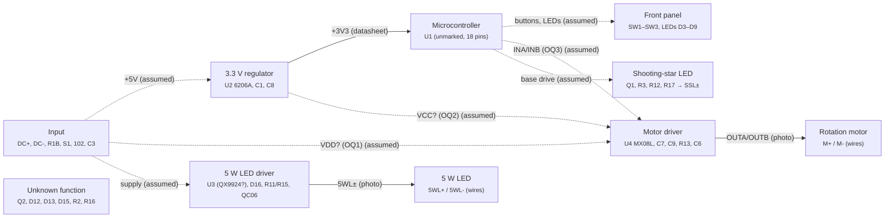

# Board model: netlist

Generated by `build.py` from `model.yaml` (E007-01GE047-02XP REV:00 2018-07-05). Do not edit by hand.

## Confidence levels

| Level       | Meaning                                                                                |
| ----------- | -------------------------------------------------------------------------------------- |
| `measured`  | Checked on the board with a meter.                                                     |
| `confirmed` | Silkscreen label, a wire seen soldered to the pad, or a measurement in REPAIR_LOG.md.  |
| `photo`     | Trace, copper area or tinned strip followed in a close-up photo.                       |
| `datasheet` | Pin function from the part's datasheet; the part number itself is read from the photo. |
| `assumed`   | Standard circuit practice or placement only. Treat as a hypothesis.                    |

## Nets

| Net        | Weakest link | Connections                                                                                                                                               | Description                                                        |
| ---------- | ------------ | --------------------------------------------------------------------------------------------------------------------------------------------------------- | ------------------------------------------------------------------ |
| `DC+`      | `assumed`    | J_DCP.1 (confirmed), R1B.1 (photo), S1.1 (assumed)                                                                                                        | 5 V input from the USB cable, before the power switch.             |
| `R1B_IN`   | `photo`      | J_R1B.1 (confirmed), R1B.2 (photo)                                                                                                                        | Third input wire, through 100 Ω into DC+.                          |
| `GND`      | `assumed`    | J_DCN.1 (confirmed), U4.6 (datasheet), U4.7 (datasheet), U2.1 (datasheet), Q1.2 (assumed), C1.2 (assumed), C8.2 (assumed), C9.2 (assumed), C7.2 (assumed) | Ground return.                                                     |
| `+5V`      | `assumed`    | S1.2 (assumed), U2.2 (assumed), C8.1 (assumed), J_SSLP.1 (assumed)                                                                                        | Supply after the power switch (assumed).                           |
| `+3V3`     | `assumed`    | U2.3 (datasheet), C1.1 (assumed)                                                                                                                          | 3.3 V regulator output, probably the MCU supply.                   |
| `U4_VDD`   | `assumed`    | U4.4 (datasheet), C9.1 (assumed), C7.1 (assumed)                                                                                                          | Motor driver power supply (pin 4). Its source is an open question. |
| `M+`       | `photo`      | J_MP.1 (confirmed), U4.5 (photo), C6.1 (photo)                                                                                                            | Motor terminal +.                                                  |
| `M-`       | `assumed`    | J_MN.1 (confirmed), R13.1 (assumed), C6.2 (photo)                                                                                                         | Motor terminal −.                                                  |
| `U4_OUTA`  | `photo`      | U4.8 (photo), R13.2 (photo)                                                                                                                               | Motor driver output A, to M- through the 0 Ω link R13.             |
| `SSL-`     | `assumed`    | J_SSLN.1 (confirmed), R3.1 (assumed)                                                                                                                      | Shooting-star LED cathode, switched to ground by Q1.               |
| `Q1_C`     | `assumed`    | R3.2 (assumed), Q1.3 (assumed)                                                                                                                            | Q1 collector, LED current through R3.                              |
| `Q1_B`     | `assumed`    | Q1.1 (assumed), R12.2 (assumed), R17.1 (assumed)                                                                                                          | Q1 base drive from the MCU.                                        |
| `5WL+`     | `photo`      | J_5WLP.1 (confirmed), D16.1 (photo)                                                                                                                       | 5 W LED anode side.                                                |
| `5WL-`     | `confirmed`  | J_5WLN.1 (confirmed)                                                                                                                                      | 5 W LED cathode side.                                              |
| `ISENSE_A` | `assumed`    | R11.1 (assumed), R15.1 (assumed)                                                                                                                          | LED-driver current-sense resistors, side A.                        |
| `ISENSE_B` | `assumed`    | R11.2 (assumed), R15.2 (assumed)                                                                                                                          | LED-driver current-sense resistors, side B.                        |

### Evidence per connection

| Net        | Pin             | Confidence  | Evidence                                                                                                             |
| ---------- | --------------- | ----------- | -------------------------------------------------------------------------------------------------------------------- |
| `DC+`      | J_DCP.1 (DC+)   | `confirmed` | Pad labelled DC+; red wire soldered (top-1, parts/IMG_3631).                                                         |
| `DC+`      | R1B.1 (1)       | `photo`     | R1B's pad sits on the DC+ copper area (parts/IMG_3631).                                                              |
| `DC+`      | S1.1 (COM)      | `assumed`   | The slide switch is expected to be in series with the input; which pin is common is unknown.                         |
| `R1B_IN`   | J_R1B.1 (R1B)   | `confirmed` | Yellow wire soldered to the R1B pad (top-1, top-3; lead visible from the bottom in parts/IMG_3631).                  |
| `R1B_IN`   | R1B.2 (2)       | `photo`     | R1B's other pad sits on the R1B pad's copper (parts/IMG_3631).                                                       |
| `GND`      | J_DCN.1 (DC-)   | `confirmed` | Pad labelled DC-; black wire soldered.                                                                               |
| `GND`      | U4.6 (GND)      | `datasheet` | MX08L GND pin.                                                                                                       |
| `GND`      | U4.7 (GND)      | `datasheet` | MX08L GND pin.                                                                                                       |
| `GND`      | U2.1 (GND)      | `datasheet` | 6206 SOT-89 pin 1 is VSS.                                                                                            |
| `GND`      | Q1.2 (E)        | `assumed`   | Low-side LED switch: emitter to ground.                                                                              |
| `GND`      | C1.2 (2)        | `assumed`   | Regulator output capacitor to ground.                                                                                |
| `GND`      | C8.2 (2)        | `assumed`   | Regulator input capacitor to ground.                                                                                 |
| `GND`      | C9.2 (2)        | `assumed`   | Supply decoupling next to U4 pin 4.                                                                                  |
| `GND`      | C7.2 (-)        | `assumed`   | Bulk capacitor near U4.                                                                                              |
| `+5V`      | S1.2 (ON)       | `assumed`   | ON throw of the slide switch.                                                                                        |
| `+5V`      | U2.2 (VIN)      | `assumed`   | The 3.3 V regulator is expected to run from the switched 5 V.                                                        |
| `+5V`      | C8.1 (1)        | `assumed`   | U2 input capacitor (C8 sits at U2's input end, parts/IMG_3629).                                                      |
| `+5V`      | J_SSLP.1 (SSL+) | `assumed`   | Shooting-star LED anode on the supply; not traced.                                                                   |
| `+3V3`     | U2.3 (VOUT)     | `datasheet` | 6206 SOT-89 pin 3 is VOUT.                                                                                           |
| `+3V3`     | C1.1 (1)        | `assumed`   | C1 sits against U2 pin 3 (parts/IMG_3629, parts/IMG_3630). Downgraded 2026-11-08: placement only, no trace followed. |
| `U4_VDD`   | U4.4 (VDD)      | `datasheet` | MX08L VDD (motor supply).                                                                                            |
| `U4_VDD`   | C9.1 (1)        | `assumed`   | C9 sits against pin 4 (parts/IMG_3619). Downgraded 2026-11-08: placement only, no trace followed.                    |
| `U4_VDD`   | C7.1 (+)        | `assumed`   | REPAIR_LOG.md calls the 47 µF beside U4 its supply capacitor.                                                        |
| `M+`       | J_MP.1 (M+)     | `confirmed` | Pad labelled M+.                                                                                                     |
| `M+`       | U4.5 (OUTB)     | `photo`     | Faint trace from pin 5 (OUTB) toward the M+ pad (parts/IMG_3619).                                                    |
| `M+`       | C6.1 (1)        | `photo`     | Trace from C6's end to the M+ pad, seen in a contrast-enhanced parts/IMG_3619 (2026-11-08).                          |
| `M-`       | J_MN.1 (M-)     | `confirmed` | Pad labelled M-; black wire.                                                                                         |
| `M-`       | R13.1 (1)       | `assumed`   | R13 sits between the M- pad and U4 (parts/IMG_3619). Downgraded 2026-11-08: placement only, no trace followed.       |
| `M-`       | C6.2 (2)        | `photo`     | Trace from the M- pad along the board edge to C6's other end, contrast-enhanced parts/IMG_3619 (2026-11-08).         |
| `U4_OUTA`  | U4.8 (OUTA)     | `photo`     | Trace from R13 to pin 8 (OUTA) (parts/IMG_3619).                                                                     |
| `U4_OUTA`  | R13.2 (2)       | `photo`     | Same trace.                                                                                                          |
| `SSL-`     | J_SSLN.1 (SSL-) | `confirmed` | Pad labelled SSL-; brown wire.                                                                                       |
| `SSL-`     | R3.1 (1)        | `assumed`   | R3 (68 Ω) sits against the SSL- pad (parts/IMG_3632). Downgraded 2026-11-08: placement only, no trace followed.      |
| `Q1_C`     | R3.2 (2)        | `assumed`   | LED current limit resistor to the switch transistor.                                                                 |
| `Q1_C`     | Q1.3 (C)        | `assumed`   | SOT-23 pin 3 = collector.                                                                                            |
| `Q1_B`     | Q1.1 (B)        | `assumed`   | SOT-23 pin 1 = base.                                                                                                 |
| `Q1_B`     | R12.2 (2)       | `assumed`   | 1 kΩ base resistor (placed between Q1 and U1).                                                                       |
| `Q1_B`     | R17.1 (1)       | `assumed`   | 10 kΩ base pull-down (placed next to R12).                                                                           |
| `5WL+`     | J_5WLP.1 (5WL+) | `confirmed` | Pad labelled 5WL+.                                                                                                   |
| `5WL+`     | D16.1 (K)       | `photo`     | Tinned strip from the 5WL+ wire lead to D16's banded end (parts/IMG_3628).                                           |
| `5WL-`     | J_5WLN.1 (5WL-) | `confirmed` | Pad labelled 5WL-; black wire.                                                                                       |
| `ISENSE_A` | R11.1 (1)       | `assumed`   | Two identical 0.39 Ω parts side by side: probably in parallel (0.195 Ω).                                             |
| `ISENSE_A` | R15.1 (1)       | `assumed`   | Same.                                                                                                                |
| `ISENSE_B` | R11.2 (2)       | `assumed`   | Same as ISENSE_A.                                                                                                    |
| `ISENSE_B` | R15.2 (2)       | `assumed`   | Same.                                                                                                                |

## Open questions

| ID  | Question                                                 | Pins                       | Check                                                                                                                                  |
| --- | -------------------------------------------------------- | -------------------------- | -------------------------------------------------------------------------------------------------------------------------------------- |
| OQ1 | Where does U4's motor supply (pin 4, VDD) come from?     | U4.4                       | Power off: continuity from U4 pin 4 to DC+, to each S1 pin and to C3's + lead.                                                         |
| OQ2 | Is U4's logic supply (pin 1, VCC) on 3.3 V or 5 V?       | U4.1                       | Unit on, idle (no button pressed): U4 pin 1 to GND. About 3.3 V means U2's output; about 5 V means the input.                          |
| OQ3 | Which U1 pins drive U4's inputs (pins 2 and 3)?          | U4.2, U4.3                 | Power off: continuity from U4 pins 2 and 3 to each U1 pin.                                                                             |
| OQ4 | Which slide-switch pin is common, and what does it feed? | S1.1, S1.2, S1.3           | Power off, switch ON then OFF: continuity from DC+ to each S1 pin.                                                                     |
| OQ5 | What feeds the regulator input (U2 pin 2)?               | U2.2                       | Power off: continuity from U2's tab to DC+ and to S1's ON pin.                                                                         |
| OQ6 | What is on the R1B (yellow) wire?                        | J_R1B.1                    | Trace the yellow wire inside the case to its other end.                                                                                |
| OQ7 | What does Q2 drive?                                      | Q2.1, Q2.2, Q2.3           | Power off: continuity from Q2's collector to SSL-, M+, M- and the front-panel LEDs; from its base, through its resistor, to U1's pins. |
| OQ8 | What are D10 and D11 (M1) for, next to U4?               | D10.1, D10.2, D11.1, D11.2 | Power off: diode test across each, then continuity from each end to U4 pins 1 and 4, DC+ and +5V.                                      |

## Parts

| Ref    | Value                                      | Block             | Pins on a net | Unknown pins                                                  |
| ------ | ------------------------------------------ | ----------------- | ------------- | ------------------------------------------------------------- |
| C1     | ceramic                                    | 3.3 V regulator   | 2 of 2        | —                                                             |
| C3     | 470 µF 16 V                                | Input             | 0 of 2        | 1, 2                                                          |
| C6     | ceramic                                    | Motor driver      | 2 of 2        | —                                                             |
| C7     | 47 µF 16 V                                 | Motor driver      | 2 of 2        | —                                                             |
| C8     | ceramic                                    | 3.3 V regulator   | 2 of 2        | —                                                             |
| C9     | ceramic                                    | Motor driver      | 2 of 2        | —                                                             |
| C11    | 100 µF 16 V                                | 5 W LED driver    | 0 of 2        | 1, 2                                                          |
| D3     | yellow LED                                 | Front panel       | 0 of 2        | 1, 2                                                          |
| D4     | green LED                                  | Front panel       | 0 of 2        | 1, 2                                                          |
| D5     | red LED                                    | Front panel       | 0 of 2        | 1, 2                                                          |
| D6     | red LED                                    | Front panel       | 0 of 2        | 1, 2                                                          |
| D7     | red LED                                    | Front panel       | 0 of 2        | 1, 2                                                          |
| D8     | yellow LED                                 | Front panel       | 0 of 2        | 1, 2                                                          |
| D9     | green LED                                  | Front panel       | 0 of 2        | 1, 2                                                          |
| D10    | M1 (1N4001-class, SMA)                     | Motor driver      | 0 of 2        | 1, 2                                                          |
| D11    | M1 (1N4001-class, SMA)                     | Motor driver      | 0 of 2        | 1, 2                                                          |
| D12    | glass diode (LL-34)                        | Unknown function  | 0 of 2        | 1, 2                                                          |
| D13    | glass diode (LL-34)                        | Unknown function  | 0 of 2        | 1, 2                                                          |
| D15    | glass diode (LL-34)                        | Unknown function  | 0 of 2        | 1, 2                                                          |
| D16    | SK34 Schottky                              | 5 W LED driver    | 1 of 2        | 2                                                             |
| J_5WLN | 5 W LED −                                  | 5 W LED driver    | 1 of 1        | —                                                             |
| J_5WLP | 5 W LED +                                  | 5 W LED driver    | 1 of 1        | —                                                             |
| J_DCN  | 5 V input −                                | Input             | 1 of 1        | —                                                             |
| J_DCP  | 5 V input +                                | Input             | 1 of 1        | —                                                             |
| J_MN   | motor −                                    | Motor driver      | 1 of 1        | —                                                             |
| J_MP   | motor +                                    | Motor driver      | 1 of 1        | —                                                             |
| J_R1B  | unknown input                              | Input             | 1 of 1        | —                                                             |
| J_SSLN | shooting-star LED −                        | Shooting-star LED | 1 of 1        | —                                                             |
| J_SSLP | shooting-star LED +                        | Shooting-star LED | 1 of 1        | —                                                             |
| L_102  | marked 102 (1 mH?)                         | Input             | 0 of 2        | 1, 2                                                          |
| L_QC06 | marked QC 06                               | 5 W LED driver    | 0 of 2        | 1, 2                                                          |
| Q1     | Y1 (SS8050-class NPN), SOT-23              | Shooting-star LED | 3 of 3        | —                                                             |
| Q2     | Y1 (SS8050-class NPN), SOT-23              | Unknown function  | 0 of 3        | 1, 2, 3                                                       |
| R1     | 100 Ω (101)                                | 5 W LED driver    | 0 of 2        | 1, 2                                                          |
| R1B    | 100 Ω (101)                                | Input             | 2 of 2        | —                                                             |
| R2     | 10 kΩ (103)                                | Unknown function  | 0 of 2        | 1, 2                                                          |
| R3     | 68 Ω (680)                                 | Shooting-star LED | 2 of 2        | —                                                             |
| R11    | 0.39 Ω (R390)                              | 5 W LED driver    | 2 of 2        | —                                                             |
| R12    | 1 kΩ (102)                                 | Shooting-star LED | 1 of 2        | 1                                                             |
| R13    | 0 Ω (000)                                  | Motor driver      | 2 of 2        | —                                                             |
| R14    | 10 Ω (100)                                 | 5 W LED driver    | 0 of 2        | 1, 2                                                          |
| R15    | 0.39 Ω (R390)                              | 5 W LED driver    | 2 of 2        | —                                                             |
| R16    | 680 Ω (681)                                | Unknown function  | 0 of 2        | 1, 2                                                          |
| R17    | 10 kΩ (103)                                | Shooting-star LED | 1 of 2        | 2                                                             |
| R19    | 300 Ω (301)                                | 5 W LED driver    | 0 of 2        | 1, 2                                                          |
| R20    | 0 Ω (000)                                  | 5 W LED driver    | 0 of 2        | 1, 2                                                          |
| R21    | 10 kΩ (103)                                | 5 W LED driver    | 0 of 2        | 1, 2                                                          |
| S1     | ON/OFF slide switch                        | Input             | 2 of 3        | 3                                                             |
| SW1    | tactile button                             | Front panel       | 0 of 2        | 1, 2                                                          |
| SW2    | tactile button                             | Front panel       | 0 of 2        | 1, 2                                                          |
| SW3    | tactile button                             | Front panel       | 0 of 2        | 1, 2                                                          |
| U1     | unmarked 18-pin MCU                        | Microcontroller   | 0 of 18       | 1, 2, 3, 4, 5, 6, 7, 8, 9, 10, 11, 12, 13, 14, 15, 16, 17, 18 |
| U2     | 6206A 1952/33 (3.3 V LDO)                  | 3.3 V regulator   | 3 of 3        | —                                                             |
| U3     | D9924 2006 (likely QX9924 buck LED driver) | 5 W LED driver    | 0 of 8        | 1, 2, 3, 4, 5, 6, 7, 8                                        |
| U4     | Mixic MX08L (1949H)                        | Motor driver      | 5 of 8        | 1, 2, 3                                                       |

## Block diagram

