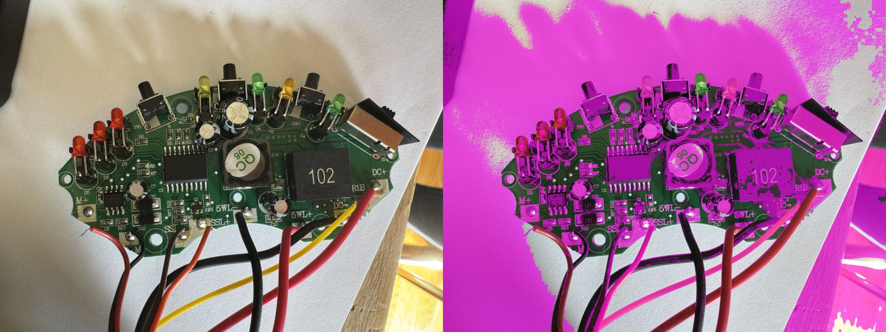
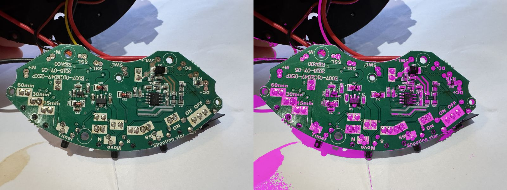
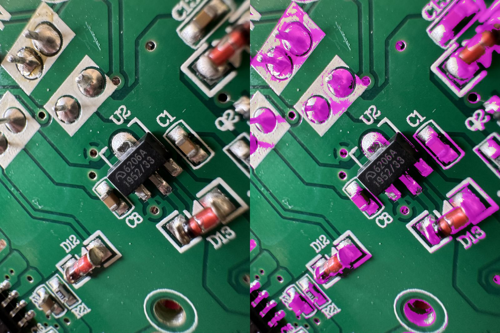
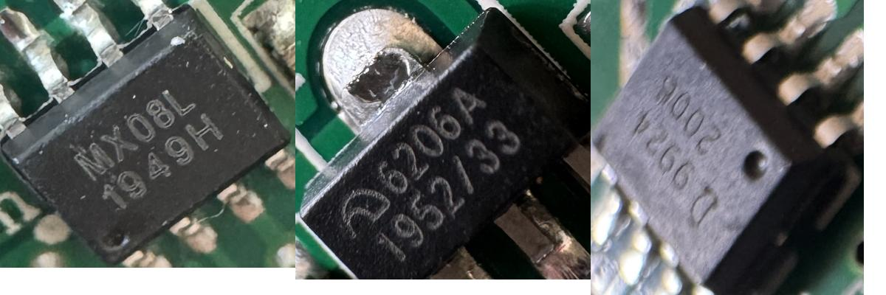

# re:trace analysis of the board photos

**Date:** 2026-11-07
**Tool:** [re:trace](https://github.com/ericrihm/retrace) v0.3.0, commit `c1a394d` (2026-05-23), with its optional `[ocr]` and `[detection]` extras.
**Question:** can re:trace, run on this repo's photos, confirm the parts identified by hand and answer the log's open questions about the board's connections?

## Summary

**No.** re:trace found none of the board's parts, read no chip markings and extracted no real traces. Nothing it produced can be used in the repair.

- **Detection:** its detector is a general-purpose YOLO model (`yolov8n.pt`), not one trained on PCBs. It found 0 parts on 7 of 9 photos. On the other 2 it found one false positive each: U1 detected as a "book", and a dark blob at the photo's edge detected as a "person".
- **OCR:** it only reads markings inside detected parts, so it read none. Given boxes drawn by hand around U4, U2 and U3, its OCR still returned nothing. A rotation-aware EasyOCR pass gets only fragments (`MXOBL`, `1952/33`).
- **Part matching:** its part database is wrong for this board. `MX08L` matches MAX17048, `6206A` matches MAX77620 and `SK34` matches S32K344, all confidently and all wrong.
- **Traces:** it looks for bare-copper colours. On this board that means the white paper, the wood, solder joints, component leads and the white silkscreen pad outlines. The real traces, under green solder mask, are never selected.

The hand identifications in `REPAIR_LOG.md` stand. The open questions about connections need a multimeter. See [connection checks](#connection-checks).

## Method

1. Installed re:trace from its repository into its own Python 3.13 virtual environment. Versions: torch 2.15.0, easyocr 1.7.2, ultralytics 8.4.206, opencv-python-headless 5.0.0, scikit-image 0.26.0, all running on the CPU.
2. Ran `retrace scan` on 9 photos: `top-1`, `top-4`, `bottom-1`, and close-ups `IMG_3619`, `IMG_3626`, `IMG_3628`, `IMG_3629`, `IMG_3630`, `IMG_3631`.
3. Checked each stage separately, because the pipeline's summary alone doesn't show why it fails:
   - [`scripts/copper_mask.py`](scripts/copper_mask.py) renders the copper mask that trace extraction starts from.
   - [`scripts/ocr_check.py`](scripts/ocr_check.py) feeds hand-placed chip boxes to re:trace's OCR and matcher, and looks up the true markings in its database.
4. Scored each result against the parts table in [`REPAIR_LOG.md`](../../REPAIR_LOG.md#board-reference).

**Setup pitfall:** with the standard `opencv-python` package on a machine without `libGL`, OpenCV fails to import. re:trace catches that error at every stage and quietly reports "0 components, 0 traces" in 0.3 s. The fix is `opencv-python-headless`. All results below are from runs where OpenCV loaded correctly.

## Results

### Pipeline output per photo

| Photo            | Parts found            | Markings read | "Traces" | Time (s) |
| ---------------- | ---------------------- | ------------- | -------- | -------- |
| `top-1.jpg`      | 0                      | 0             | 661      | 32       |
| `top-4.jpg`      | 0                      | 0             | 398      | 20       |
| `bottom-1.jpg`   | 0                      | 0             | 320      | 21       |
| `parts/IMG_3619` | 0                      | 0             | 811      | 28       |
| `parts/IMG_3626` | 1 (U1 as a "book")     | 0             | 536      | 30       |
| `parts/IMG_3628` | 0                      | 0             | 528      | 21       |
| `parts/IMG_3629` | 1 (blob as a "person") | 0             | 434      | 20       |
| `parts/IMG_3630` | 0                      | 0             | 485      | 20       |
| `parts/IMG_3631` | 0                      | 0             | 541      | 21       |

The cross-board pattern matching found nothing on any photo, because it works on detected parts.

### Parts against the log

| Part                                 | Found by re:trace | Marking read | Identified as                     |
| ------------------------------------ | ----------------- | ------------ | --------------------------------- |
| U1 (18-pin, unmarked)                | As a "book"       | None         | Nothing                           |
| U2 (`6206A`, 3.3 V regulator)        | No                | None         | MAX77620 if given `6206A` (wrong) |
| U3 (`9624`, LED driver)              | No                | None         | No match                          |
| U4 (`MX08L`, motor driver)           | No                | None         | MAX17048 if given `MX08L` (wrong) |
| Q1, Q2 (`Y1`, SOT-23)                | No                | None         | SE050 if given `SS8050` (wrong)   |
| D16 (SK34)                           | No                | None         | S32K344 if given `SK34` (wrong)   |
| D12, D13, D15, `R390`, electrolytics | No                | n/a          | n/a                               |

**Score: 0 of the logged parts found or identified.**

### Copper mask

Magenta marks the pixels re:trace treats as copper. The share of each photo in the mask is: `top-1` 59.6 %, `top-4` 24.5 %, `IMG_3619` 28.6 %, `IMG_3629` 15.3 %, `bottom-1` 11.6 %.

| `top-1`: the paper background and wires            | `bottom-1`: the pads and paper; no traces                |
| -------------------------------------------------- | -------------------------------------------------------- |
|  |  |

In the close-up of U2 below, the traces are visible by eye as lighter green lines. The mask selects only the pads, solder joints and component bodies around them:



### OCR on hand-placed chip boxes



| Chip | By eye           | re:trace OCR | Raw EasyOCR                | EasyOCR with rotation search |
| ---- | ---------------- | ------------ | -------------------------- | ---------------------------- |
| U4   | `MX08L 1949H`    | (none)       | `RIXO8` 0.19, `4949h` 0.68 | `MXOBL` 0.95, `2` 0.91       |
| U2   | `6206A 1952/33`  | (none)       | `8` 0.55, `8` 0.17         | `8` 0.55, `1952/33` 0.97     |
| U3   | `9624` (blurred) | (none)       | `(`, `2`, `2`              | `2`, `2`, `(`                |

Even the best case misreads `MX08L` as `MXOBL`. For U2 it reads only the date code and voltage suffix (`1952/33`), not the part number.

## Why it doesn't work here

- **There are no PCB-trained detection weights.** The default `yolov8n.pt` is trained on everyday objects; a PCB-trained model needs to be supplied for detection to work at all. Its classes are mapped onto PCB labels by index (`detection/detector.py`), so "person", class 0, becomes "ic".
- **Trace extraction looks for bare copper.** It needs exposed copper, as on an unmasked or delayered board. Traces under solder mask, and any background in shot, defeat it. It also only finds connected blobs, not which pad connects to which.
- **The part database is small** (128 parts, aimed at security work) and its fuzzy matcher accepts a 55 % string similarity. Markings it doesn't know therefore come back as a confident wrong part, not "unknown".
- **The photos are hard for it:** taken by hand at an angle, with background and wires in shot. Better photos alone would not fix the three issues above.

## Connection checks

re:trace answers none of the log's open questions. These multimeter checks do, without pressing Move or Shooting Star:

| Question                                   | Check                                                                                                                                                     |
| ------------------------------------------ | --------------------------------------------------------------------------------------------------------------------------------------------------------- |
| What feeds U4's logic supply (pin 1, VCC)? | Unit on, idle: measure U4 pin 1 to GND (pin 6 or 7). About 3.3 V means U2 feeds it; about 5 V means the input does. Power off: continuity to U2's output. |
| What feeds U4's motor supply (pin 4, VDD)? | Power off: continuity from pin 4 to `DC+`, to the power switch's output, and to the 47 µF capacitor's + lead.                                             |
| What does `R1B` connect to?                | Power off: continuity from the `R1B` pad to `DC+`, `DC-`, the power switch pins and U1's pins; read the value of the resistor marked `R1B` beside it.     |
| What does Q2 drive?                        | Power off: continuity from Q2's collector to `SSL-`, `M+`/`M-` and the front-panel LEDs; from its base, through its resistor, to U1's pins.               |

## Reproduce

```sh
git clone https://github.com/ericrihm/retrace /tmp/ext/retrace   # third-party: keep it outside this repo
python3 -m venv /tmp/retrace-venv
/tmp/retrace-venv/bin/pip install -e "/tmp/ext/retrace[ocr,detection]"
/tmp/retrace-venv/bin/pip uninstall -y opencv-python && /tmp/retrace-venv/bin/pip install opencv-python-headless
/tmp/retrace-venv/bin/retrace scan photos/top-1.jpg --format svg -o /tmp/retrace-out/top-1
/tmp/retrace-venv/bin/python -I analysis/retrace/scripts/copper_mask.py photos/top-1.jpg /tmp/top-1-mask.jpg
/tmp/retrace-venv/bin/python -I analysis/retrace/scripts/ocr_check.py photos /tmp/retrace-crops
```

The first run downloads the YOLO weights and EasyOCR models (about 100 MB), plus about 1 GB for PyTorch.
