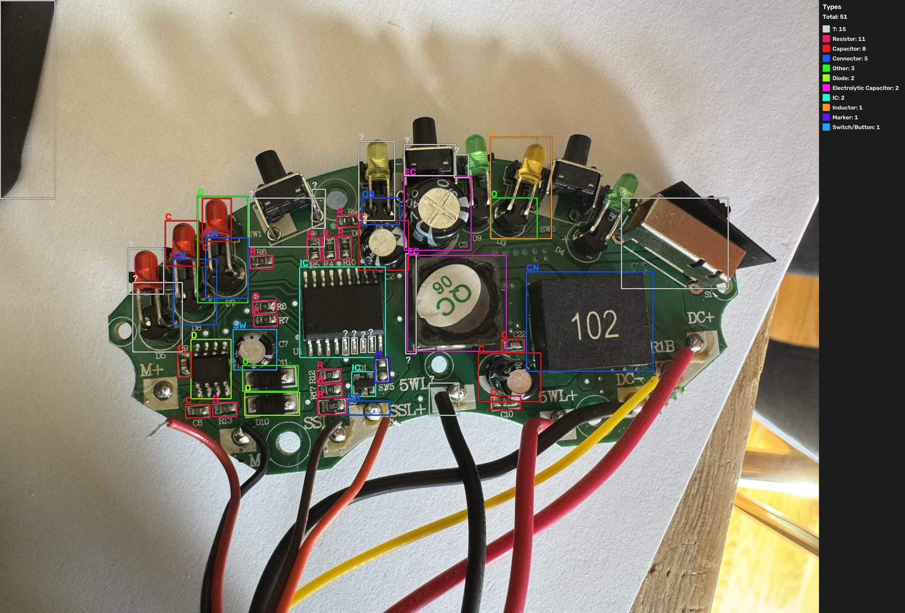
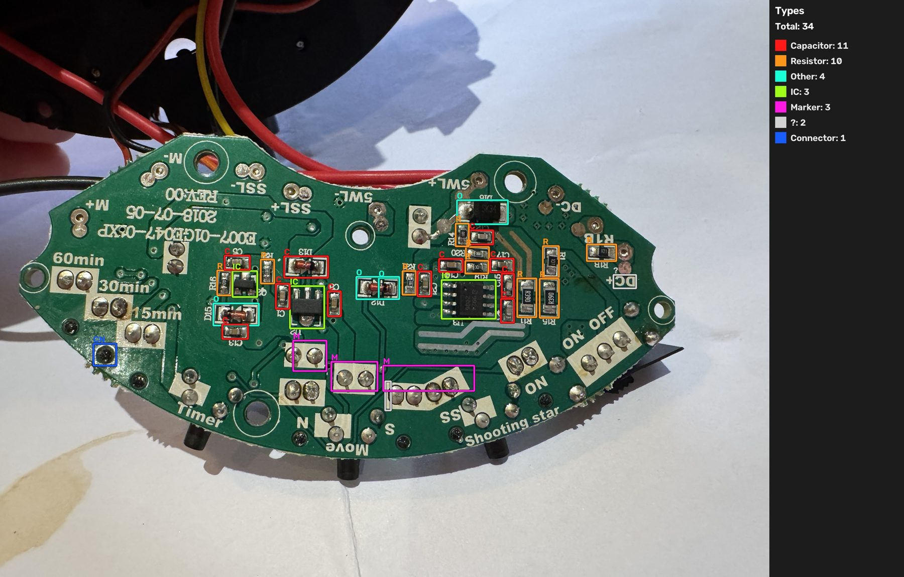
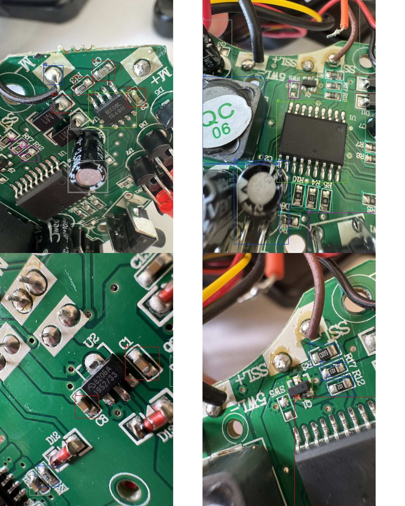
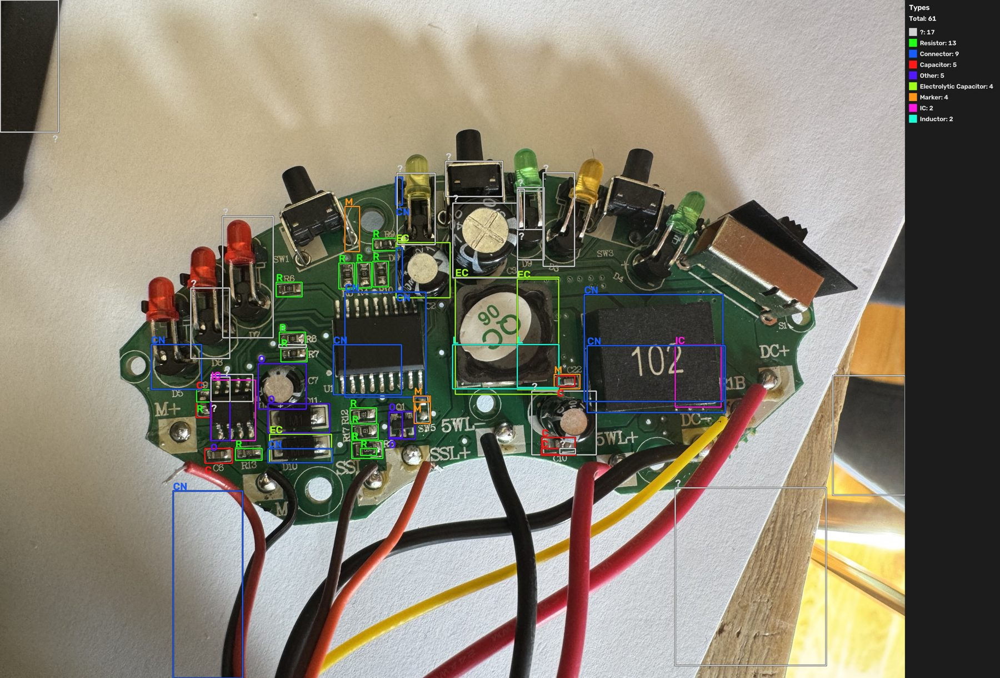

# PCB-trained YOLO model on the board photos

**Date:** 2026-11-07
**Model:** [pcb-component-detection-yolo26](https://github.com/ParsaVictor/pcb-component-detection-yolo26) (MIT), commit `123768b`. Weights `any_best.pt` (SHA-256 `1065cdb4a32d6579…`) and `fine_best.pt` (`79a0f399c2fb33a8…`), run with its `hr/infer/predict.py`.
**Why this model:** re:trace's advertised PCB-trained model was never published (see [the re:trace analysis](../retrace/README.md)). This is a public model trained on populated boards. It has two YOLO26s stages: a locator that finds components, and a typer that names 13 types.
**Question:** does a PCB-trained detector find and correctly type this board's parts?

## Summary

**Partly. It finds most parts and types ICs and SMD passives well, but mislabels most through-hole parts. It adds nothing new to the diagnosis.**

- **Locating:** good. In the best view of each part it put a box on 41 of the 46 parts scored below. It missed 3 of the 8 LEDs and 2 of the 5 switches, and found nothing at all on U2's close-ups.
- **Typing:**
  - Reliable for **ICs** and **SMD resistors and capacitors**. All four ICs were named correctly in at least one photo.
  - Poor for this board's **through-hole parts**: 0 of 8 LEDs, 0 of 5 switches and 0 of 2 inductors got the right label.
  - Diodes and transistors were mixed: 1 of 6 diodes and 1 of 2 transistors were labelled correctly.
- **Errors that would mislead:**
  - **U4, the prime suspect, is labelled a diode** in the whole-board photo. It is named an IC only in its close-up.
  - Q1 and Q2 are labelled ICs in the board views.
  - The `102` inductor is labelled a connector, and the `QC06` inductor an electrolytic capacitor.
- **What it can't do:** read markings or follow connections. It names a part's type, not its part number or what it connects to. The log's open questions still need the meter checks in [the re:trace analysis](../retrace/README.md#connection-checks).

This model is far better than re:trace's generic detector, which found 0 parts. It would be useful for a quick inventory of an SMD-heavy board, but everything it gets right here is already in `REPAIR_LOG.md`.

## Method

1. Ran the model's `hr/infer/predict.py` with both stages (`--mode both`), 1024 px tiles (`--tile 1024`), on the CPU. I didn't use the optional Random Forest stage for the "?" boxes, because it loads compressed pickles that I couldn't inspect.
2. **Safety check before loading:** `.pt` files are Python pickles, which can run code when loaded. A scan of both files' pickle opcodes, without loading them, found references only to PyTorch, Ultralytics, `collections.OrderedDict` and `set`.
3. **Scale:** the model was trained on parts about 19 px wide, and its script doesn't rescale photos automatically. I swept the scale on `top-1.jpg` (see [scale sweep](#scale-sweep)) and used 0.5 for the 4032 px board photos, 1.0 for the 2016 px ones (`top-4`, `bottom-1`) and 0.15 for the close-ups, where parts are about 3.4 times larger.
4. **Scoring:** compared each part's boxes and labels by eye against the [board reference](../../REPAIR_LOG.md#board-reference), using each part's best photo.

## Results

### Whole-board photos

| Top side (`top-1`, scale 0.5)                         | Bottom side (`bottom-1`, scale 1.0)                         |
| ----------------------------------------------------- | ----------------------------------------------------------- |
|  |  |

Labels: `IC`, `R` resistor, `C` capacitor, `EC` electrolytic, `D` diode, `Q` transistor, `L` inductor, `CN` connector, `SW` switch, `O` other, `M` marker (silkscreen), `?` located but type uncertain.

### Close-ups (scale 0.15)



Top left: `IMG_3619`, with U4 found as an IC. Top right: `IMG_3626`, with U1 an IC, Q1 a transistor and the resistors correct. Bottom left: `IMG_3629`, where U2, D12 and D13 are missed. Bottom right: `IMG_3632`, with Q1 a transistor and the resistors correct.

### Parts against the log

| Part                                | Located | Correct type  | Labels given (photo)                                                   |
| ----------------------------------- | ------- | ------------- | ---------------------------------------------------------------------- |
| U1 (18-pin MCU)                     | Yes     | Yes           | IC (`top-1`, `IMG_3626`)                                               |
| U2 (`6206A` regulator)              | Yes     | Yes           | IC (`bottom-1`); not found in `IMG_3629`/`IMG_3630` at any scale       |
| U3 (`9624` LED driver)              | Yes     | Yes           | IC (`bottom-1`)                                                        |
| U4 (`MX08L` motor driver)           | Yes     | Close-up only | IC (`IMG_3619`); **diode** (`top-1`)                                   |
| Q1 (`Y1`, SOT-23)                   | Yes     | Close-up only | Transistor (`IMG_3626`, `IMG_3632`); IC (`top-1`)                      |
| Q2 (`Y1`, SOT-23)                   | Yes     | No            | IC (`bottom-1`)                                                        |
| D10, D11 (`M1`, SMA)                | 2 of 2  | 1 of 2        | Diode and other (`top-1`); missed in `IMG_3619`                        |
| D12, D13, D15, D16 (glass and SK34) | 4 of 4  | 0 of 4        | Other ×3, capacitor (`bottom-1`); missed in `IMG_3629`                 |
| LEDs D3–D9 and ON (8)               | 5 of 8  | 0 of 8        | Capacitor, connector, other, inductor or `?`                           |
| Electrolytics C2, C3, C7, C10       | 4 of 4  | 2 of 4        | C3 and C2 electrolytic; C10 capacitor; C7 (47 µF beside U4) **switch** |
| Inductors (`QC06`, `102`)           | 2 of 2  | 0 of 2        | Electrolytic; connector                                                |
| Buttons SW1–SW4 and slide switch S1 | 3 of 5  | 0 of 5        | `?`                                                                    |
| SMD resistors checked (15)          | 15      | 15            | Resistor. Top: R3–R10, R12, R13, R17. Bottom: R16, `R1B`, 2 × `R390`   |
| **Total (46 parts)**                | **41**  | **23**        |                                                                        |

The resistor row covers the 15 resistors I could read on the silkscreen. Small ceramic capacitors were also labelled "capacitor" in nearly every case, but they aren't counted in the total.

**False positives** on `top-1` included:

- boxes on the background and the wires;
- four `?` boxes on U1's individual pins;
- the `SSL+` pad labelled as a connector.

On `bottom-1`: a mounting hole labelled as a connector, and the rows of solder pads as silkscreen markers.

### Scale sweep

On `top-1.jpg`:

| Scale | Boxes | ICs | Notes                                                                          |
| ----- | ----- | --- | ------------------------------------------------------------------------------ |
| 1.0   | 61    | 2   | U1 labelled a connector; the `102` inductor both a connector and an IC; 17 `?` |
| 0.5   | 51    | 2   | U1 correct; fewest background boxes; used for the results above                |
| 0.33  | 47    | 2   | Similar to 0.5                                                                 |
| 0.25  | 36    | 4   | Parts merge and are lost                                                       |

The U2 close-ups (`IMG_3629`, `IMG_3630`) were also tried at scales 0.1, 0.25 and 0.35. U2 was never located.



## Why it falls short here

- **The training boards are mostly SMD development boards** (its examples are Avnet and Digilent boards). This board's large through-hole parts, such as 5 mm LEDs, tactile buttons, a slide switch and big power inductors, are rare in that data. They come out as connectors, capacitors or "other".
- **Close-ups are out of range:** the model expects whole-board scale, so even rescaled close-ups lose parts (U2, D12, D13).
- **Detection isn't diagnosis:** a box and a type label can't show a failed part, a part number or a net.

## Reproduce

```sh
git clone https://github.com/ParsaVictor/pcb-component-detection-yolo26 /tmp/ext2/pcb-component-detection-yolo26
# in a venv with ultralytics>=8.4, torch, torchvision and opencv-python-headless
python -I /tmp/ext2/pcb-component-detection-yolo26/hr/infer/predict.py \
  --source photos/top-1.jpg --mode both \
  --any /tmp/ext2/pcb-component-detection-yolo26/weights/any_best.pt \
  --fine /tmp/ext2/pcb-component-detection-yolo26/weights/fine_best.pt \
  --tile 1024 --scale 0.5 --device cpu --out /tmp/yolo26-out/top-1
```

Use `--scale 1.0` for `top-4` and `bottom-1`, and `--scale 0.15` for the close-ups. Each run writes `<photo>_types.jpg`, `<photo>_elements.jpg` and a CSV of boxes.
